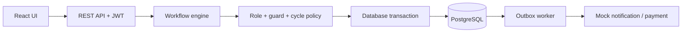

# Claims Workflow Orchestrator

Ứng dụng quản lý vòng đời hồ sơ bồi thường: kiểm tra điều kiện trước khi chuyển trạng thái, phân quyền theo vai trò, xử lý side effect qua outbox và lưu audit trail bất biến.

**Stack:** Java 21 · Spring Boot · JPA/Hibernate · Lombok · PostgreSQL · React · Vite.

## 1. Bắt đầu từ requirements

Đọc tài liệu theo thứ tự:

1. [AI Challenge 14](docs/AI_Challenge_14.md): yêu cầu nghiệp vụ, bảng transition, precondition, role và 5 test scenario bắt buộc.
2. [System design](docs/system_design.md): kiến trúc, mô hình dữ liệu, transaction, API và xử lý lỗi.
3. [Workflow configuration](src/main/resources/workflow.yaml): cấu hình thực tế mà backend nạp khi khởi động.
4. [Mock preconditions](docs/mock-preconditions.md): các API giả lập dùng để chuẩn bị điều kiện cho từng transition.

Các yêu cầu chính được triển khai như sau:

| Yêu cầu | Thành phần thực hiện |
| --- | --- |
| State machine theo cấu hình | `workflow.yaml`, `WorkflowDefinition`, `WorkflowEngine` |
| Kiểm tra precondition | `GuardHandler`, các strategy trong `service/guard/`, `GuardRegistry` |
| Phân quyền | JWT, `Actor`, enum `Role`, kiểm tra role và assessor được giao |
| Chống cập nhật đồng thời | JPA `@Version` và `expectedVersion` |
| Chống xử lý request lặp | Header `Idempotency-Key`, bảng `idempotency_requests` |
| Side effect có retry | `ActionHandlerRegistry`, các action strategy, `OutboxWorker` |
| Audit chỉ insert/read | `AuditRepository`, entity immutable, PostgreSQL grants và trigger |
| Giới hạn bổ sung thông tin | Tối đa 3 lần vào `PENDING_INFO`; lần thứ 4 bị từ chối |
| Giao diện thao tác | React trong `frontend/`, hiển thị role, điều kiện và audit history |

## 2. Hiểu luồng trong system design



Một transition thành công sẽ cập nhật claim, thêm audit, hoàn tất/tạo task, thêm outbox event và lưu kết quả idempotency trong cùng transaction. Worker thực hiện side effect sau khi transaction commit.

Nếu role, guard hoặc cycle policy không hợp lệ, transition bị từ chối. Claim không chuyển state và không có audit thành công cho thao tác bị từ chối.

Cấu trúc thư mục:

```text
claimworkflow/
├── docs/                         # Requirements, system design, hướng dẫn và evidence
├── infra/                        # Docker Compose, bootstrap DB, script sửa role/grant
├── frontend/                     # React + Vite
├── scripts/                      # Chạy 5 scenario và xuất evidence
├── src/main/java/com/papaya/claimworkflow/
│   ├── api/                      # REST controller, error advice
│   ├── config/                   # Security, workflow config, scheduling
│   ├── domain/                   # Actor
│   ├── dto/                      # Request DTO
│   ├── entity/                   # JPA entity, converter
│   ├── enums/                    # Role, state, transition, action, guard
│   ├── repository/               # Persistence và audit append-only
│   └── service/                  # Orchestrator, guard/action strategy, outbox
├── src/main/resources/
│   ├── workflow.yaml
│   └── db/migration/             # V001, V002, V003
└── src/test/                     # Unit test và PostgreSQL integration test
```

## 3. Chuẩn bị môi trường

| Công cụ | Mục đích |
| --- | --- |
| JDK 21 | Build và chạy backend |
| Maven Wrapper `./mvnw` | Sử dụng Maven của project, không bắt buộc cài Maven riêng |
| Docker + Compose v2 | Chạy PostgreSQL 17 |
| Node.js 20.19+ hoặc 22.12+ và npm | Build/chạy React + Vite |
| Python 3 | Xuất báo cáo 5 scenario |
| `psql` trên host, tùy chọn | Chạy script sửa role/grant cho DB đã tồn tại |

Kiểm tra:

```bash
java -version
node --version
npm --version
docker compose version
python3 --version
```

Các lệnh dưới đây chạy từ **thư mục gốc repository**, trừ khi có `cd frontend`. Lần build đầu cần mạng để tải Maven/dependency. Trên Windows, dùng `mvnw.cmd` thay cho `./mvnw`.

## 4. Khởi động PostgreSQL bằng Docker

Mở Docker engine, sau đó chạy:

```bash
docker compose -f infra/compose.yaml config --quiet
docker compose -f infra/compose.yaml up -d --wait
docker compose -f infra/compose.yaml ps
```

Kết quả mong đợi: service `postgres` ở trạng thái **healthy**.

### 4.1. Database mới: tự tạo schema và seed

Khi volume còn trống, Docker tự chạy [001-bootstrap.sh](infra/init/001-bootstrap.sh):

1. Tạo PostgreSQL runtime role `claimworkflow_app`.
2. Chạy [V001__workflow.sql](src/main/resources/db/migration/V001__workflow.sql): tạo claim, audit, task, outbox, idempotency và receipt.
3. Chạy [V002__audit_permissions.sql](src/main/resources/db/migration/V002__audit_permissions.sql): cấp quyền runtime, chặn sửa/xóa/truncate audit.
4. Chạy [V003__users_and_roles.sql](src/main/resources/db/migration/V003__users_and_roles.sql): tạo `app_users`, `user_roles` và insert seed users.

**Không cần tự chạy lại các file SQL khi bootstrap mới đã thành công.** Backend dùng `ddl-auto=validate` và `spring.sql.init.mode=never`; khởi động BE không tự tạo bảng hoặc chạy migration.

### 4.2. Thông tin kết nối local

| Thiết lập | Giá trị mặc định |
| --- | --- |
| Host / port | `127.0.0.1:5432` |
| Database | `claimworkflow` |
| Admin DB user / password | `claimworkflow` / `claimworkflow_local` |
| Runtime DB user / password | `claimworkflow_app` / `claimworkflow_app_local` |

Admin dùng để migration, seed và quản trị. BE và integration test nên dùng runtime role `claimworkflow_app` để áp dụng đúng quyền audit chỉ insert/read.

Mở SQL console trong container:

```bash
docker compose -f infra/compose.yaml exec postgres sh -c 'psql -U "$POSTGRES_USER" -d "$POSTGRES_DB"'
```

Trong console, kiểm tra bảng và users:

```sql
\dt

SELECT u.subject, u.tenant_id, r.role, u.enabled
FROM app_users u
JOIN user_roles r ON r.user_id = u.user_id
ORDER BY u.subject;
```

Gõ `\q` để thoát.

### 4.3. Database/volume đã tồn tại

Docker **không chạy lại bootstrap trên volume cũ**. Nếu bảng workflow đã có nhưng thiếu runtime role, audit grant hoặc seed users, dùng:

```bash
./infra/configure-runtime-role.sh
```

Lệnh này cần `psql` trên host. Script tạo/cấu hình runtime role rồi chạy lại V002 và V003; nó **không chạy V001** và không xóa dữ liệu.

Nếu DB còn trống nhưng là volume đã tồn tại, trước tiên chạy V001 bằng admin:

```bash
docker compose -f infra/compose.yaml exec -T postgres sh -c \
  'psql -U "$POSTGRES_USER" -d "$POSTGRES_DB" -v ON_ERROR_STOP=1 -f /migrations/V001__workflow.sql'

./infra/configure-runtime-role.sh
```

Chỉ chạy V001 khi các bảng chưa tồn tại. Nếu dùng SQL client thay vì script: kết nối admin, tạo `claimworkflow_app` nếu thiếu, rồi chạy V001 → V002 → V003 theo tình trạng schema. Không chạy migration bằng tài khoản runtime.

## 5. Seed users và insert dữ liệu

Phân biệt hai loại role:

- `claimworkflow_app` là **PostgreSQL role** để BE kết nối DB.
- `document_clerk`, `team_lead`, `assessor`, `finance`, `system` là **role nghiệp vụ**, lưu trong `user_roles` và đưa vào JWT.

V003 seed các tài khoản sau, tất cả thuộc tenant `tenant-a`:

| User ID (`subject`) | Role | Nhiệm vụ demo |
| --- | --- | --- |
| `clerk-1` | `document_clerk` | Tạo claim, upload/nhận tài liệu |
| `lead-1` | `team_lead` | Gán assessor, bắt đầu assessment |
| `assessor-1` | `assessor` | Hoàn tất assessment, approve/reject/request info |
| `assessor-2` | `assessor` | Assessor khác để kiểm tra quyền người được giao |
| `finance-1` | `finance` | Khởi tạo và xác nhận thanh toán |
| `system-1` | `system` | Xử lý acknowledgement/appeal và đóng claim bị từ chối |

Muốn thêm user demo, chạy bằng admin trong SQL console:

```sql
BEGIN;

INSERT INTO app_users (
    user_id, tenant_id, subject, display_name, enabled, created_at, updated_at
) VALUES (
    '10000000-0000-0000-0000-000000000007',
    'tenant-a', 'assessor-3', 'Additional Assessor', TRUE,
    CURRENT_TIMESTAMP, CURRENT_TIMESTAMP
)
ON CONFLICT (tenant_id, subject) DO NOTHING;

INSERT INTO user_roles (user_id, role)
SELECT user_id, 'assessor'
FROM app_users
WHERE tenant_id = 'tenant-a' AND subject = 'assessor-3'
ON CONFLICT (user_id, role) DO NOTHING;

COMMIT;
```

Bảng users hiện không lưu password. API login demo tra cứu user đang enabled bằng `tenantId` và `subject`. Claim được tạo qua UI/API, không cần insert claim hoặc audit thủ công.

## 6. Chạy backend

Mở **terminal A** tại root:

```bash
export DATABASE_URL=jdbc:postgresql://127.0.0.1:5432/claimworkflow
export DATABASE_USER=claimworkflow_app
export DATABASE_PASSWORD=claimworkflow_app_local

./mvnw spring-boot:run -Dspring-boot.run.profiles=local
```

Truyền rõ runtime credentials để không phụ thuộc tài khoản mặc định trong file properties. Nếu đã đổi password khi bootstrap, dùng giá trị đã cấu hình.

Kiểm tra log có profile **`local`**, server chạy ở **http://localhost:8080**. Các API `/api/v1/mock/...` chỉ được đăng ký trong profile `local` hoặc `test`.

Trong IntelliJ: mở Spring Boot Run Configuration, đặt **Active profiles = `local`** và các biến `DATABASE_*` tương ứng. Sau khi đổi profile/config cần restart BE.

Thử login tại **terminal B**:

```bash
curl --fail-with-body -X POST http://localhost:8080/api/v1/auth/login \
  -H 'Content-Type: application/json' \
  -d '{"tenantId":"tenant-a","subject":"clerk-1"}'
```

Response chứa `token`, `tokenType`, `expiresIn`, `subject`, `tenantId`, `roles`. Các request nghiệp vụ tiếp theo gửi header `Authorization: Bearer <token>`.

## 7. Chạy frontend React + Vite

Tại **terminal B**, từ root:

```bash
cd frontend
npm ci
npm run dev
```

Mở **http://localhost:5173**. FE proxy `/api` đến BE `http://127.0.0.1:8080`.

1. Chọn **Connect your account**.
2. Điền tenant `tenant-a`, user `clerk-1`.
3. Chọn **New claim**, nhập amount `500.00`, policy limit `1000.00`.
4. Chọn claim để xem state, các transition, required role và lý do bị chặn.
5. Dùng **Prepare claim conditions** để cập nhật điều kiện giả lập.
6. Dùng **Advance claim**, nhập reason để chuyển state.
7. Dùng **Switch account** khi bước tiếp theo yêu cầu role khác.
8. Mở **Audit trail** để xem lịch sử; **Export JSON** tải toàn bộ audit của claim.

FE tự gửi `expectedVersion` và `Idempotency-Key`; người dùng không phải nhập hai giá trị này.

Nếu BE chạy ở địa chỉ khác, trong `frontend/`:

```bash
cp .env.example .env.local
```

Sửa `API_PROXY_TARGET` trong `.env.local` rồi restart Vite. Xem thêm [frontend README](frontend/README.md).

## 8. Demo happy path từng bước trên UI

Giữ cùng một claim trong suốt luồng. Đổi account trong cùng tenant sẽ giữ claim đang chọn.

| Bước | Account | Prepare claim conditions | Sau đó Advance claim đến |
| --- | --- | --- | --- |
| 1 | `clerk-1` | Upload required documents | `DOCUMENTS_VERIFIED` |
| 2 | `lead-1` | Assign an assessor: `assessor-1` | `UNDER_ASSESSMENT` |
| 3 | `assessor-1` | Complete assessment report | `APPROVED` |
| 4 | `finance-1` | Process payment request, hoặc đợi outbox worker | `PAYMENT_INITIATED` |
| 5 | `finance-1` | Process payment, sau đó Confirm payment reference: `PAYMENT-123` | `CLOSED` |

Sau mỗi thao tác, UI tải lại claim và danh sách transition. Nếu action chưa hiện ready, bấm refresh để lấy trạng thái side effect mới nhất. Happy path tạo **5 audit entry**, bắt đầu từ `SUBMITTED` và kết thúc ở `CLOSED`.

Các luồng còn lại:

- **Rejection:** tại `UNDER_ASSESSMENT`, `assessor-1` hoàn tất assessment và nhập rejection reason, chuyển `REJECTED`. Đổi sang `system-1`, record member acknowledgement hoặc simulate appeal expiry, rồi chuyển `CLOSED`.
- **Request info:** tại `UNDER_ASSESSMENT`, `assessor-1` mô tả thông tin thiếu rồi chuyển `PENDING_INFO`. `clerk-1` nhận additional information và chuyển `DOCUMENTS_VERIFIED`; `lead-1` bắt đầu assessment lại. Tiếp tục approve/payment để đóng claim. Báo cáo assessment phải được hoàn tất lại sau vòng bổ sung.
- **Invalid transition:** thử `SUBMITTED → APPROVED` qua API; nhận `409 INVALID_TRANSITION`. UI chỉ liệt kê đường đi từ state hiện tại nên không cung cấp nút thực hiện transition này.
- **Unauthorized role:** dùng `finance-1` thử approve claim đang `UNDER_ASSESSMENT` qua API; nhận `403 UNAUTHORIZED_TRANSITION`. UI hiển thị required role và khóa nút đối với account không được phép.

Mock upload chỉ cập nhật flag, không lưu file tài liệu thật. Điều kiện amount/policy limit được tính từ số tiền; điều kiện payment dựa trên outbox receipt, không bật cờ tùy ý. Danh sách route/body chi tiết ở [mock preconditions](docs/mock-preconditions.md).

## 9. Các API chính

Các route dưới đây có prefix `/api/v1`:

| Method | Route | Chức năng |
| --- | --- | --- |
| POST | `/auth/login` | Lấy JWT cho user demo |
| POST | `/claims` | Tạo claim ở `SUBMITTED` |
| GET | `/claims` | Danh sách claim theo tenant |
| GET | `/claims/{id}` | State, version, facts hiện tại |
| GET | `/claims/{id}/transitions?includeUnauthorized=true` | Tất cả đường đi, required roles và readiness |
| POST | `/claims/{id}/transitions` | Yêu cầu chuyển state |
| GET | `/claims/{id}/audit?limit=50&offset=0` | Audit theo sequence number |
| GET | `/claims/{id}/workflow` | Task, cycle counter, số audit và side effect pending |
| GET | `/claims/{id}/effects` | Trạng thái side effect và receipt |
| PATCH | `/claims/{id}/evidence` | Cập nhật facts theo role/state |
| POST | `/mock/<operation>/{id}` | Giả lập dữ liệu precondition trong local/test |

Ví dụ chuyển state bằng API, thay claim ID, token và version bằng giá trị thực tế:

```bash
curl --fail-with-body -X POST 'http://localhost:8080/api/v1/claims/<claim-id>/transitions' \
  -H 'Authorization: Bearer <token>' \
  -H 'Content-Type: application/json' \
  -H 'Idempotency-Key: verify-documents-001' \
  -d '{"toState":"DOCUMENTS_VERIFIED","expectedVersion":1,"reason":"Documents checked"}'
```

`expectedVersion` phải khớp `version` của claim vừa đọc. Khi gửi lại cùng request do lỗi mạng, dùng lại cùng `Idempotency-Key`; thao tác mới cần key mới. Nếu nhận `409 CONCURRENT_MODIFICATION`, đọc lại claim và xem xét dữ liệu mới trước khi thử lại.

## 10. Chạy test và xuất evidence cho 5 scenario

Giữ PostgreSQL đang chạy. Integration test dùng DB trực tiếp; không cần mở riêng BE hoặc FE.

Tại root, dùng runtime role có quyền audit insert/read:

```bash
export TEST_DATABASE_URL=jdbc:postgresql://127.0.0.1:5432/claimworkflow
export TEST_DATABASE_USER=claimworkflow_app
export TEST_DATABASE_PASSWORD=claimworkflow_app_local

./mvnw test
```

Chỉ chạy bộ E2E:

```bash
./mvnw -Dtest=WorkflowEndToEndTests test
```

Chạy đúng 5 scenario yêu cầu và xuất file cấu hình, kết quả test, audit trail:

```bash
python3 scripts/run-workflow-scenarios.py
```

Kết quả nằm trong `docs/examples/workflow-run-<timestamp>/`:

```text
workflow.yaml                 # Snapshot cấu hình dùng trong lần test
RESULTS.md                    # Bảng kết quả 5 scenario
scenario-results.json         # Status, claim ID, duration, số audit
audit-trails.json            # Audit lấy từ PostgreSQL cho từng scenario
scenario-evidence/*.json      # Request/response, workflow, effects và audit
surefire/                     # Report JUnit
maven.log                     # Log đầy đủ
```

Chỉ coi bộ evidence hoàn tất khi `scenario-results.json` có `complete: true`.

| Scenario | Kết quả mong đợi | Audit entry |
| --- | --- | --- |
| Happy path | Đến `CLOSED` | 5 |
| Rejection path | Đến `CLOSED` | 4 |
| Request info loop → approve/payment | Đến `CLOSED` | 8 |
| Invalid transition | Bị từ chối, giữ `SUBMITTED` | 0 |
| Unauthorized role | Bị từ chối, giữ `UNDER_ASSESSMENT` | 2 entry từ các bước setup hợp lệ |

Đã có [bộ evidence với đủ 5 scenario PASSED](docs/examples/workflow-run-20261023T061315862774Z/RESULTS.md). Chi tiết cách xuất lại: [submission evidence](docs/examples/README.md).

Test tạo claim có UUID riêng và không xóa audit sau khi chạy. Ngoài 5 scenario còn kiểm tra precondition, giới hạn 3 vòng, lần thứ 4 bị từ chối, idempotency, tenant isolation, stale version và quyền audit. Không dùng profile Maven `offline-check` để chạy integration test vì profile này bỏ PostgreSQL driver.

## 11. Build và cấu hình khác

Build BE kèm test, từ root:

```bash
./mvnw clean verify
```

Build FE, chạy trong `frontend/`:

```bash
npm test
npm run build
npm run preview
```

FE production output ở `frontend/dist/`, preview tại **http://localhost:4173**. Java build output ở `target/`. React chạy độc lập với console HTML cũ tại cổng 8080.

Nếu cổng DB `5432` đang bận:

```bash
export POSTGRES_PORT=5433
docker compose -f infra/compose.yaml up -d --wait
```

Giữ biến `POSTGRES_PORT` cho các lệnh Compose tiếp theo và cập nhật `DATABASE_URL`, `TEST_DATABASE_URL` sang cổng `5433`. Đổi port không thay đổi nội dung DB trong volume.

## 12. Xử lý lỗi thường gặp

| Lỗi | Kiểm tra / cách xử lý |
| --- | --- |
| `role "claimworkflow_app" does not exist` | Volume cũ chưa bootstrap role; chạy `./infra/configure-runtime-role.sh` bằng cấu hình admin phù hợp. |
| `relation ... does not exist` / schema validation failed | Kiểm tra đúng database/schema và thứ tự V001 → V002 → V003. BE không tự migration. |
| `password authentication failed` | Phân biệt admin password và app password; thay biến môi trường không tự đổi password trong volume đã có. |
| `No static resource api/v1/mock/...` | Restart BE với profile `local`; kiểm tra FE proxy đúng BE. Request mock phải dùng POST. |
| `403 UNAUTHORIZED_TRANSITION` / `UNAUTHORIZED_EVIDENCE` | Đổi đúng role; thao tác assessment chỉ dành cho assessor đã được giao. |
| `409 PRECONDITION_FAILED` | Thực hiện Prepare claim conditions, kiểm tra payment outbox hoặc refresh. |
| `409 CONCURRENT_MODIFICATION` | Claim đã được cập nhật; lấy version mới trước thao tác tiếp theo. |
| `409 CYCLE_LIMIT_EXCEEDED` | Đã có 3 yêu cầu bổ sung; lần thứ 4 bị chặn theo requirement. |
| `401 UNAUTHENTICATED` | Đăng nhập lại, kiểm tra token/issuer và JWT secret thống nhất. |
| Test báo context failure threshold | Đọc lỗi `Caused by` đầu tiên; kiểm tra DB, credential và migrations. |
| FE không gọi được API | Kiểm tra BE cổng 8080, `API_PROXY_TARGET`, rồi restart Vite. |

Xem log và dừng database:

```bash
docker compose -f infra/compose.yaml logs --tail=100 postgres
docker compose -f infra/compose.yaml down
```

`down` giữ dữ liệu. Chỉ dùng `docker compose -f infra/compose.yaml down --volumes` khi chủ động muốn **xóa toàn bộ DB local**, gồm cả audit history; lần `up` tiếp theo sẽ bootstrap lại từ đầu.
