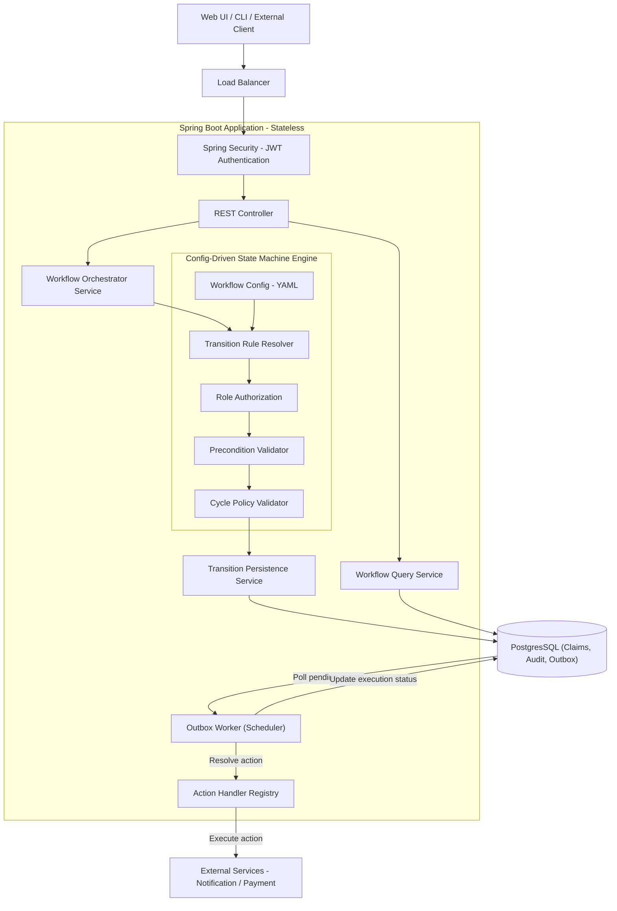
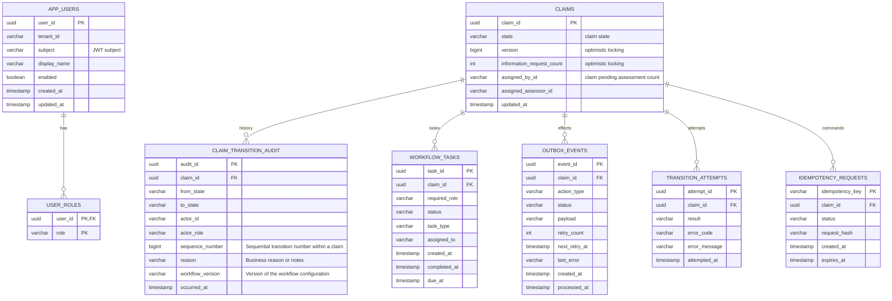
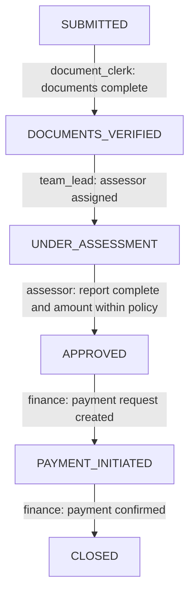
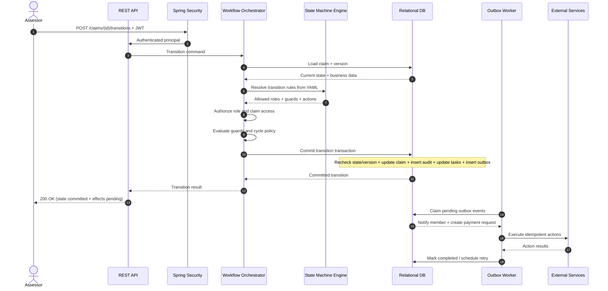
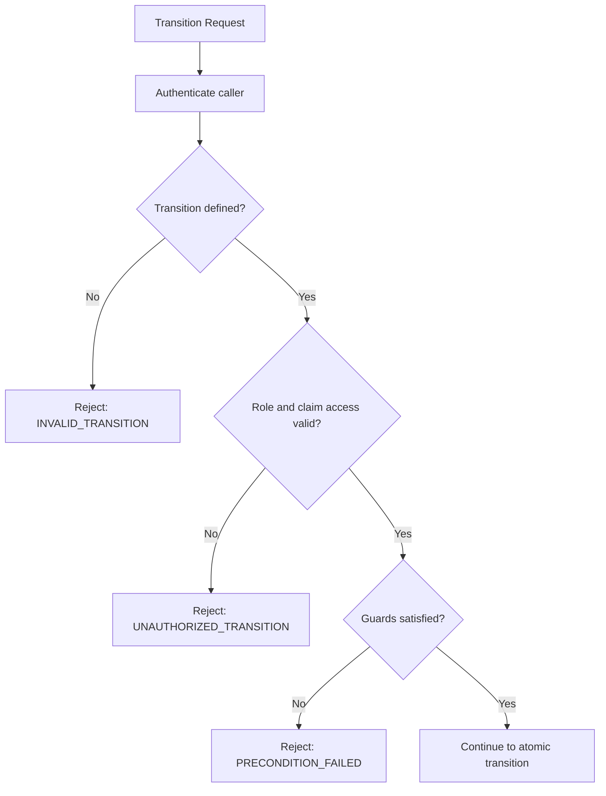
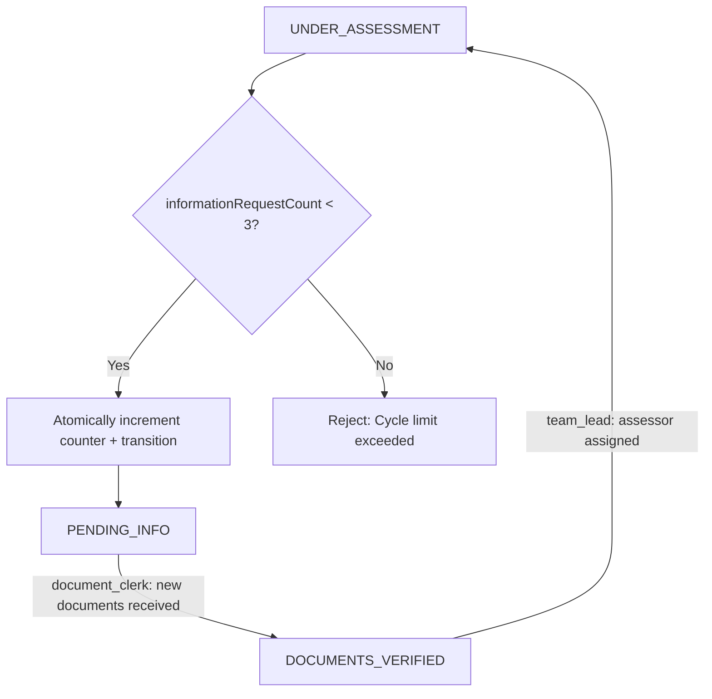
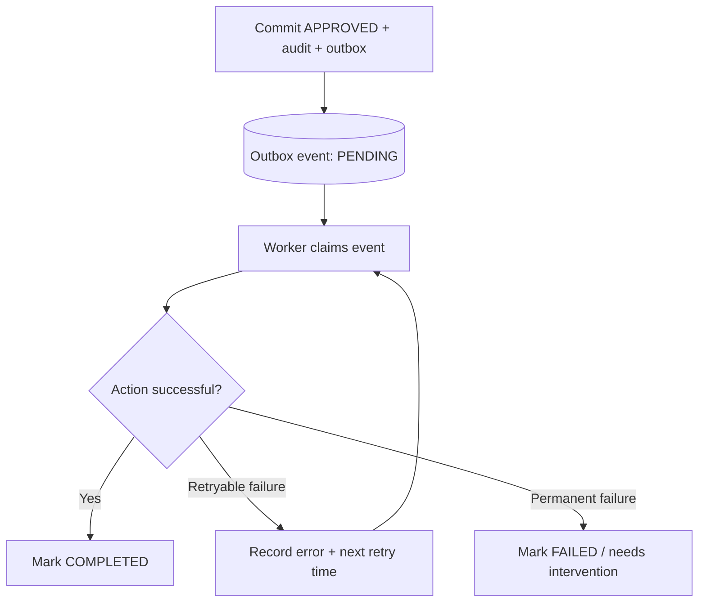

# Functional Requirements
- Define states/transitions by YAML file
- Can view the current state of claim
- Validate state transitions
- Validate transition preconditions
- Role-based authorization
- Execute side effects if successful transition
- Immutable transaction audit trail: `claim_transition_audit` permits insert and read only
- Query audit trail by Claim ID
- Detect 3 claim lifecycles
- Web UI shows claim and available transitions by user role

# Non-Functional Requirements
- New claims per day: 10,000 => average 10,000/86,400 = 0.116 claims/second
- Transitions per claim: 6 => average 0.116 x 6 = 0.694 transitions/second
- Peak multiplier: 10 => approximately 6.94 transition TPS (size the service with additional headroom)
- Consistency: prevent invalid state transition
  - Solution: optimistic locking
- Prevent duplicate transactions
  - Solution: idempotency
- Security: prevent unauthorized access
  - Solution: role-based authorization
- Observability: audit trail of all transactions
  - Solution: immutable transaction log
- Reliability: failed side effects can be retried
  - Solution: outbox pattern
- Scalability: smoothest performance for a large number of request claims
  - Solution: horizontal scaling

# High-Level Design

| Component | Description |
| --- | --- |
| Web UI / CLI / External Client | Provides interfaces for users or external systems to submit claim transition requests, view claim status, and retrieve workflow history. |
| Load Balancer | Distributes incoming requests across multiple Spring Boot instances to support high availability and horizontal scaling. |
| REST Controller | Exposes REST APIs for claim management, state transitions, available transitions, and workflow history. |
| Spring Security (JWT Authentication) | Authenticates incoming requests, validates JWT tokens, and extracts trusted user identity and roles. |
| Workflow Orchestrator Service | Coordinates the overall claim lifecycle by invoking the state machine engine, managing transitions, and triggering subsequent workflow activities. |
| Config-Driven State Machine Engine | Evaluates workflow transitions based on YAML configuration, ensuring that state changes comply with defined business rules. |
| Transition Persistence Service | Atomically updates claim state, cycle counters, and workflow tasks, and inserts audit records and outbox events while enforcing concurrency control. |
| Workflow Query Service | Retrieves current claim status, available transitions, pending tasks, and historical audit records for monitoring and tracking. |
| Outbox Worker (Scheduler) | Periodically processes pending outbox events and triggers corresponding actions, with retry handling for failed executions. |
| Action Handler Registry | Resolves and executes the appropriate action handlers, such as sending notifications, creating payment requests, or initiating payments. |
| PostgreSQL | Acts as the source of truth for claim states, workflow progress, immutable audit records, and pending outbox events. |
| External Services | Integrates with downstream systems responsible for notifications, payment processing, and other business operations. |

## State Machine Engine
- **Workflow Config (YAML)** - Defines the state machine and transition rules.
- **Transition Rule Resolver** - Resolves transition rules based on the current state and transition request.
- **Role Authorization** - Ensures that the user has the required role to perform the requested transition.
- **Precondition Validator** - Validates preconditions for the transition, such as claim status or cycle completion.
- **Cycle Policy Validator** - Enforces a maximum number of cycles for a given state.

# Data Model


`app_users` is a tenant-scoped directory keyed by the JWT `subject`. Roles are
stored in `user_roles`, allowing one user to hold multiple workflow roles. JWT
validation remains the authentication source; this table contains no passwords
or token material.

## Audit Table Access Rules

`claim_transition_audit` is append-only: allow `INSERT` and `SELECT` only. Existing audit entries must never be updated or deleted.

- Enforce this in PostgreSQL permissions as well as application code. The runtime role must have no `UPDATE`, `DELETE`, or `TRUNCATE` privileges on this table, including through inherited roles or `PUBLIC` grants.
- Use a dedicated runtime role that is neither a superuser nor the table owner and cannot assume the migration/owner role. Keep schema migration credentials separate from application credentials.
- Do not expose audit update/delete APIs or repository methods. Avoid foreign-key cascade actions that could modify or delete audit history when a claim changes or is deleted.
- Insert the audit entry in the same transaction as the successful claim transition. Any later correction must be represented by a new entry, preserving the original.
- Add database integration tests using the runtime role: inserts and reads succeed; updates, deletes, and truncation are denied; claim deletion cannot cascade into audit history.

These permissions must be implemented with the audit-table migration; the current local Docker setup only provisions an empty database.

# Workflow configuration
```yaml
# Workflow configuration example
workflow:
  id: claim-lifecycle
  version: 1

  states:
    - SUBMITTED
    - DOCUMENTS_VERIFIED
    - UNDER_ASSESSMENT
    - PENDING_INFO
    - APPROVED
    - REJECTED
    - PAYMENT_INITIATED
    - CLOSED

  policies:
    informationRequestLimit:
      type: TRANSITION_COUNTER
      counter: informationRequestCount
      max: 3
      error: "Maximum information requests exceeded — escalate to team lead"

  transitions:
    - id: request-more-information
      from: UNDER_ASSESSMENT
      to: PENDING_INFO
      roles: [assessor]

      guards:
        - missingInfoDescriptionProvided

      policies:
        - informationRequestLimit

      actions:
        - notifyMemberWithRequestDetails

      nextTask:
        type: WAIT_FOR_NEW_INFORMATION
        requiredRole: document_clerk
```

## React Web UI

The React + Vite client is in `frontend/`. See [frontend setup](../frontend/README.md).
It shows current claim state, all outgoing transitions with required roles and
blocking conditions, and ordered audit history with JSON export. The UI supplies
optimistic versions and idempotency keys automatically. Use
`GET /api/v1/claims/{id}/transitions?includeUnauthorized=true` to inspect all
outgoing paths; execution remains restricted by the normal authorization checks.

# API Design

Local precondition simulation endpoints and instructions for the five challenge scenarios
are documented in [Mock preconditions](mock-preconditions.md).

| Method | Endpoint | Chức năng |
| --- | --- | --- |
| GET | /api/v1/claims/{id} | Get current claim |
| GET | /api/v1/claims/{id}/transitions | Xem available transitions |
| POST | /api/v1/claims/{id}/transitions | Request state transition |
| GET | /api/v1/claims/{id}/audit | Get immutable audit history |
| GET | /api/v1/claims/{id}/workflow | Get lifecycle + pending tasks + effects |
| GET | /api/v1/workflow-tasks | Query pending tasks by role/user |
| GET | /api/v1/claims/{id}/effects | Side-effect execution status |

Error responses:

| HTTP Code | Error Code | Description |
|-----------|---------------------------|------------------------------------------|
| 400 | INVALID_REQUEST | Request data sai |
| 401 | UNAUTHENTICATED | Authentication thất bại |
| 403 | UNAUTHORIZED_TRANSITION | User không đủ quyền |
| 404 | CLAIM_NOT_FOUND | Claim không tồn tại hoặc không được phép truy cập |
| 409 | INVALID_TRANSITION | Không có transition hợp lệ |
| 409 | PRECONDITION_FAILED | Business guard không đạt |
| 409 | CYCLE_LIMIT_EXCEEDED | Vượt số lần bổ sung thông tin |
| 409 | CONCURRENT_MODIFICATION | State/version đã thay đổi |

## API Request transition
```http request
POST /api/v1/claims/CLM-001/transitions
Authorization: Bearer <JWT>
Idempotency-Key: 9f243d...
Content-Type: application/json

{
  "toState": "APPROVED",
  "expectedVersion": 5,
  "reason": "Assessment report reviewed"
}
```

Response:
```json
{
  "transitionId": "TR-1001",
  "claimId": "CLM-001",
  "fromState": "UNDER_ASSESSMENT",
  "toState": "APPROVED",
  "version": 6,
  "status": "COMMITTED",
  "sideEffects": {
    "status": "PENDING",
    "actions": [
      "notifyMember",
      "createPaymentRequest"
    ]
  }
}
```

## API GET Available Transitions
Request:
```http request
GET /api/v1/claims/CLM-001/transitions
Authorization: Bearer <JWT>
Content-Type: application/json
```

Response:
```json
{
  "claimId": "CLM-001",
  "currentState": "UNDER_ASSESSMENT",
  "transitions": [
    {
      "toState": "APPROVED",
      "requiredRoles": ["assessor"],
      "preconditions": [
        "assessmentComplete",
        "amountWithinPolicyLimit"
      ]
    },
    {
      "toState": "REJECTED",
      "requiredRoles": ["assessor"]
    },
    {
      "toState": "PENDING_INFO",
      "requiredRoles": ["assessor"],
      "remainingInformationRequests": 1
    }
  ]
}
```

## API GET Workflow Progress
Request:
```http request
GET /api/v1/claims/CLM-001/workflow
Authorization: Bearer <JWT>
Content-Type: application/json
```

Response:
```json
{
  "claimId": "CLM-001",
  "workflow": "claim-lifecycle",
  "version": 1,
  "currentState": "UNDER_ASSESSMENT",
  "pendingTasks": [
    {
      "type": "ASSESS_CLAIM",
      "requiredRole": "assessor",
      "assignedTo": "user-123",
      "status": "PENDING"
    }
  ],
  "cycleCounters": {
    "informationRequestCount": 1
  },
  "pendingSideEffects": 0,
  "historyCount": 5
}
```

# Scaling
## Database Scaling
- I'm using PostgreSQL for the database, and index for query columns.
```sql
CREATE INDEX idx_claims_state
ON claims(current_state);

CREATE INDEX idx_claim_audit_claim_sequence
ON claim_transition_audit(claim_id, sequence_number);

CREATE INDEX idx_tasks_role_status
ON workflow_tasks(required_role, status);

CREATE INDEX idx_outbox_status_next_retry
ON outbox_events(status, next_retry_at);
```

| Stage                     | Solution                                                        |
|---------------------------|-----------------------------------------------------------------|
| Read-heavy                | Indexing, pagination, connection pooling                        |
| Audit-heavy               | Partition audit table by time or query needs                    |
| Read scaling              | Read replicas for dashboard/reporting                           |
| High write contention     | Optimize transactions, analyze hot claims                       |
| Very high throughput      | Consider data partitioning or complex event-driven architecture |
| Avoid premature additions | no need Redis or Kafka unless specifically needed               |

## Concurrency Control
- Example: we have 2 users requesting a state transition at the same time.
- Solution 1: Optimistic locking - suitable for less-frequent updates.
```java
@Version
private Long version;
```

- Solution 2: Pessimistic locking—suitable for frequent updates, but have a risk of lock wait, deadlock, low latency.
→ With this requirement and NON-Functional Requirements, I think we can use solution 1.

## Side-effect Execution
- Instead of process to send notification service, payment service synchronously, we can use an outbox pattern.
- Pros:
  - Ensure reliable and consistent execution of side effects. Example: saves to a database but failed to send notification.
  - Application crash when executing side effects → loss of data.
  - The outbox records are stored in the same transaction with the claim transition. So we can rollback the entire transaction if there is an error.
  - Easier tracking and monitoring of side effects.
- Cons:
  - We need to worker consumer such as Kafka or Schedular to process the outbox events.
  - The outbox pattern just ensure **at-least-once delivery**. So you need to handle duplicate events.

# Full End-to-End Flow

**Project:** AI Challenge 14 — Claims Workflow Orchestrator  
**Architecture:** Java Spring Boot · JPA · Config-driven State Machine · PostgreSQL · Transactional Outbox  
**Scope:** Claim lifecycle orchestration, validation, authorization, auditing, and side effects.

> **Database note:** The implementation uses PostgreSQL for runtime and integration tests. This keeps optimistic locking, worker coordination, advisory idempotency locks, and audit-table permissions consistent across environments.

## 7.1. Full Flow A — Happy Path

### Business lifecycle



| Step | Transition | Authorized role | Precondition | Side effect |
|---|---|---|---|---|
| 1 | `SUBMITTED → DOCUMENTS_VERIFIED` | `document_clerk` | All required documents are present | Notify assessor team |
| 2 | `DOCUMENTS_VERIFIED → UNDER_ASSESSMENT` | `team_lead` | Assessor is assigned | Record assessment start time |
| 3 | `UNDER_ASSESSMENT → APPROVED` | `assessor` | Assessment report complete; amount ≤ policy limit | Notify member; create payment request |
| 4 | `APPROVED → PAYMENT_INITIATED` | `finance` | Payment request created | Trigger payment system |
| 5 | `PAYMENT_INITIATED → CLOSED` | `finance` | Payment confirmed | Notify member with payment reference |

### Technical sequence — `UNDER_ASSESSMENT → APPROVED`



**Example command:**

```http
POST /api/v1/claims/CLM-001/transitions
Authorization: Bearer <JWT>
Idempotency-Key: request-123
Content-Type: application/json
```

```json
{
  "toState": "APPROVED",
  "expectedVersion": 5,
  "reason": "Assessment report reviewed"
}
```

**Successful response:**

```json
{
  "claimId": "CLM-001",
  "fromState": "UNDER_ASSESSMENT",
  "toState": "APPROVED",
  "version": 6,
  "status": "COMMITTED",
  "sideEffects": {
    "status": "PENDING",
    "actions": ["notifyMember", "createPaymentRequest"]
  }
}
```

**Transaction boundary:**

```text
BEGIN TRANSACTION
  Recheck claim state and expected version
  Revalidate invariant business conditions (including cycle rule if applicable)
  Update claim state, counter where applicable, and version
  Insert immutable transition audit entry
  Complete previous workflow task and create next task
  Insert side-effect events into transactional outbox
  Record idempotency outcome
COMMIT
```

If a DB operation fails, the transaction rolls back entirely. Do not send external notifications or payments inside this DB transaction.

### Payment dependency

`APPROVED` **does not imply** that the payment request already exists. Immediately after approval:

```text
Claim state: APPROVED
Payment-request side effect: PENDING
```

After the outbox worker successfully creates it:

```text
Claim state: APPROVED
Payment-request side effect: COMPLETED
Payment request ID: PAY-001
```

Only then can `finance` perform `APPROVED → PAYMENT_INITIATED`, because the precondition “payment request created” is now satisfied.

## 7.2. Full Flow B — Invalid Transition / Unauthorized Role

### Example 1: Invalid state transition

Claim is `SUBMITTED` but a caller requests `APPROVED`:

```json
{
  "toState": "APPROVED",
  "reason": "Approve immediately"
}
```

The YAML definition has no `SUBMITTED → APPROVED` edge; the engine rejects the transition.

```json
{
  "code": "INVALID_TRANSITION",
  "message": "Transition SUBMITTED -> APPROVED is not allowed",
  "details": {
    "allowedTransitions": ["DOCUMENTS_VERIFIED"]
  }
}
```

### Example 2: Unauthorized role

The state transition exists, but a `finance` user attempts `UNDER_ASSESSMENT → APPROVED` (requires `assessor`). Return a specific authorization error such as `UNAUTHORIZED_TRANSITION` with HTTP 403.

**Failure invariants:**

- Claim state and version remain unchanged.
- Cycle counter remains unchanged.
- No successful transition audit entry is created.
- No workflow task is completed/created as if the transition had succeeded.
- No outbox events are created for the rejected transition.
- Optionally log the rejected command in a separate `transition_attempts` record.



## 7.3. Full Flow C — Information Request Loop

Allowed loop:

```text
UNDER_ASSESSMENT → PENDING_INFO → DOCUMENTS_VERIFIED → UNDER_ASSESSMENT
```

**Interpretation used:** Count each **successful** `UNDER_ASSESSMENT → PENDING_INFO` transition as one information request. The maximum is **3**; the fourth request is rejected before state change. This interpretation follows the challenge's error wording; the problem does not precisely specify whether to count completed loops or entry requests.



| Request | Count before | Outcome | Count after |
|---|---:|---|---:|
| 1st | 0 | Allowed | 1 |
| 2nd | 1 | Allowed | 2 |
| 3rd | 2 | Allowed | 3 |
| 4th | 3 | Rejected | 3 |

**Exact required error message:**

```text
Maximum information requests exceeded — escalate to team lead
```

Example error:

```json
{
  "code": "CYCLE_LIMIT_EXCEEDED",
  "message": "Maximum information requests exceeded — escalate to team lead",
  "details": {
    "currentState": "UNDER_ASSESSMENT",
    "attemptedState": "PENDING_INFO",
    "currentCount": 3,
    "maxAllowed": 3
  }
}
```

On rejection, the state remains `UNDER_ASSESSMENT`; no counter increment or success audit entry is written. The wording instructs escalation but the challenge **does not require** a new `ESCALATED` state. An escalation task can be an optional enhancement without changing the eight configured business states.

**Concurrent request protection:** If two requests read counter `2` and claim version `7`, use optimistic locking / a conditional update inside the DB transaction so at most one succeeds. The loser receives a conflict or is reloaded and revalidated.

## 7.4. Full Flow D — Side-Effect Failure and Retry

Example: the claim transition to `APPROVED` is committed, but sending a member notification fails.



**State after transition succeeds but notification fails:**

```text
Claim state = APPROVED
Transition audit = CREATED
Outbox event = FAILED_RETRYABLE
Retry count = 1
Next retry = according to backoff policy
```

**After a successful retry:**

```text
Claim state = APPROVED
Outbox event = COMPLETED
```

The claim must **not** revert to `UNDER_ASSESSMENT` simply because a notification failed. The business transition and the delivery status of external effects are separate concerns.

# Evaluation Criteria
- All 5 test scenarios produce correct results
- Invalid transitions are rejected with specific error messages (not generic "invalid transition")
- Preconditions are enforced (demonstrate with a case where precondition fails)
- Role authorization is enforced
- Audit trail is complete and accurate for all scenarios
- Cycle detection prevents infinite loops
- Adding a new state or transition requires only config changes (demonstrate with a diff)
- At least 15 tests covering valid transitions, invalid transitions, precondition failures, role authorization, and cycle detection
